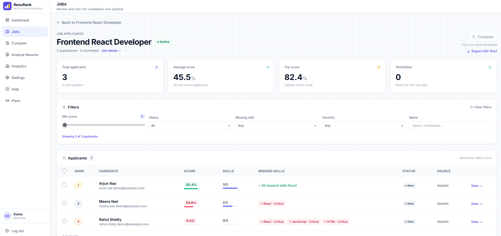
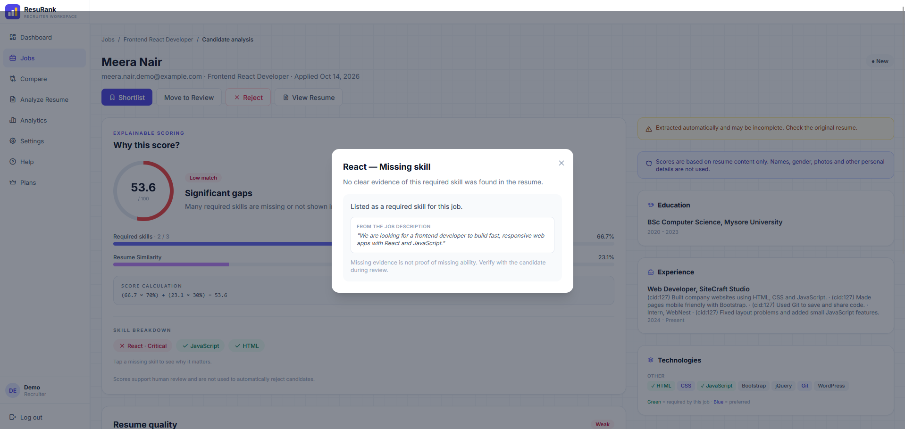
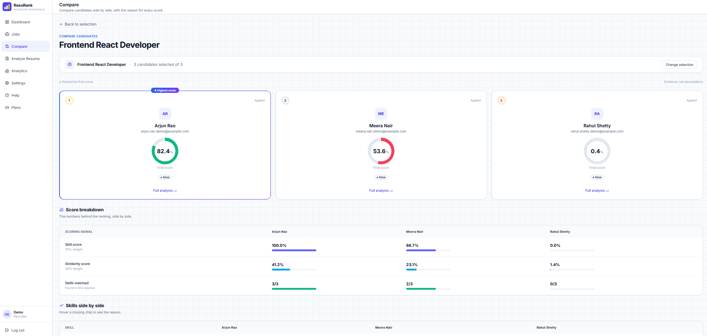
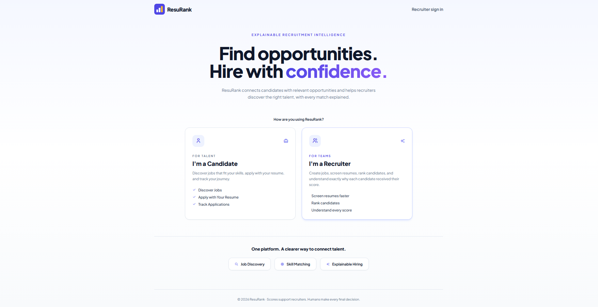
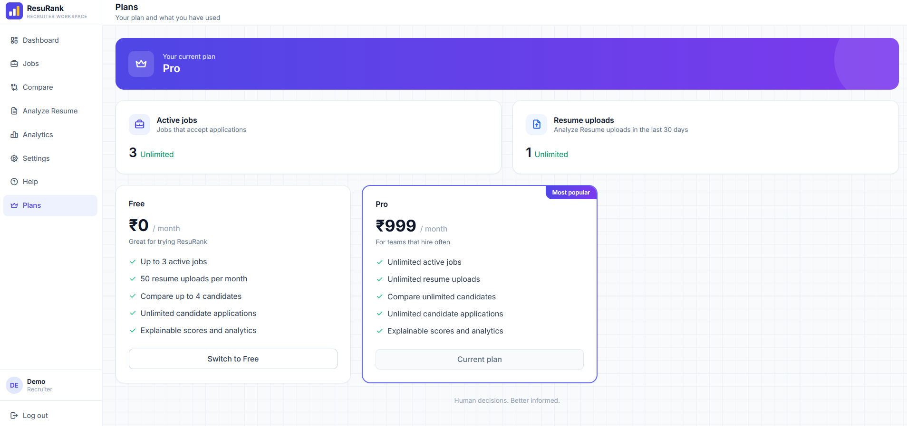

# ResuRank

**Explainable resume scoring for recruiters. Every score has a reason, and a human makes the final decision.**

Live demo: https://resurank.onrender.com
(The free server sleeps. The first load can take about 50 seconds.)

Demo video: https://youtu.be/vQcMigRY2Is

## Who it is for

Small companies, startups and college placement cells that get many resumes but cannot afford big hiring software.

## The problem

Most resume tools are black boxes. They give a number, but no reason. Recruiters cannot trust it, and candidates cannot understand it.

## The solution

ResuRank scores every resume against a job and shows exactly why:

- Which required skills were found, with evidence from the resume
- Which skills are missing, and how serious each gap is
- A text similarity score between the resume and the job description
- A resume quality check

Scores never auto-reject anyone. Names, gender and photos are never used in scoring. The recruiter always makes the final decision.

## Key features

**For recruiters**
- Create, edit, publish and close jobs, with adjustable skill and similarity weights
- Ranked applicants list for every job
- Explainable analysis page: "Why this score?" with matched and missing skills
- Compare candidates side by side
- Analyze any outside PDF resume against a job
- Analytics dashboard and status history for every application
- Recruiter data isolation: each recruiter only sees their own data

**For candidates (no account needed)**
- Browse active jobs and apply with a PDF resume
- Track the application status. The browser remembers your applications, and the tracking code works on any device
- The score is never shown to the candidate

## How scoring works

Final score = (skill score x skill weight) + (similarity score x similarity weight)

- Skill score: required skills found in the resume. It uses text cleaning and whole-word matching, and it handles names like C++ and Node.js
- Similarity score: TF-IDF with cosine similarity (scikit-learn).
- Default weights are 70 / 30. Each job can change them.

## Tech stack

- Backend: Python, Django
- Frontend: Django templates, Tailwind CSS, JavaScript
- Resume parsing: pdfplumber
- Matching: scikit-learn (TF-IDF, cosine similarity)
- Database: SQLite for local development, PostgreSQL (Neon) in production
- Background jobs: Celery and Redis (planned for background scoring)
- Deployment: Render, gunicorn, WhiteNoise, Docker
- Quality: 54 automated tests, GitHub Actions CI

## Business model

| Plan | Price | Limits |
| --- | --- | --- |
| Free | Rs 0 | 3 active jobs, 50 resume uploads per 30 days, compare up to 4 candidates |
| Pro | Rs 999 per month | Unlimited jobs, uploads and compare |

- Candidates always apply for free and are never limited.
- The checkout in this project is a demo. A payment gateway such as Razorpay would plug into the same Pay button.
- Later: a Team plan priced per recruiter.

## Scalability

- Stateless Django behind gunicorn, so more servers can be added
- PostgreSQL in production
- Celery and Redis for background scoring (planned)

## Run it locally

```
git clone https://github.com/manasat1306/resurank
cd resurank
python -m venv venv
venv\Scripts\activate
pip install -r requirements.txt
python manage.py migrate
python manage.py generate_test_data
python manage.py runserver
```

Then open http://127.0.0.1:8000

Run the tests:

```
python manage.py test
```

## Screenshots











## Limits (honest notes)

- Only PDF resumes are supported. Multi-column PDFs can be read in the wrong order.
- Skill matching is keyword based on purpose, so every match can be shown as evidence. It can miss unusual wording.
- Uploaded files on the free demo server are stored on temporary disk.

## Author

Built by Manasa T